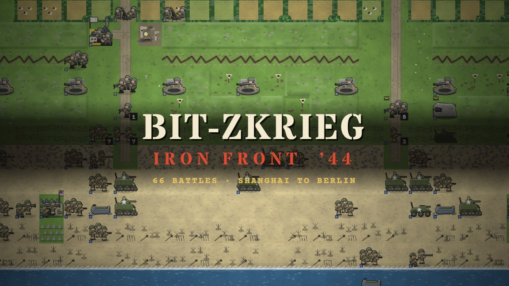
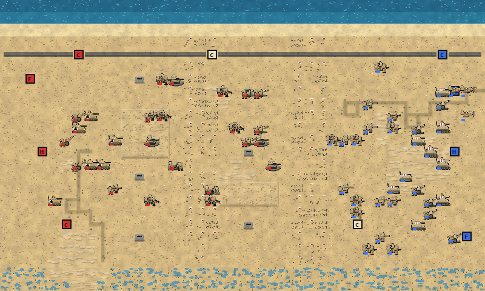
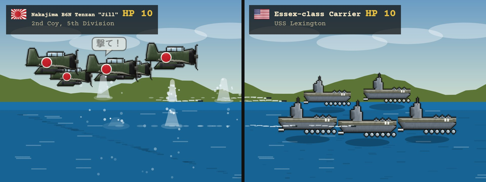
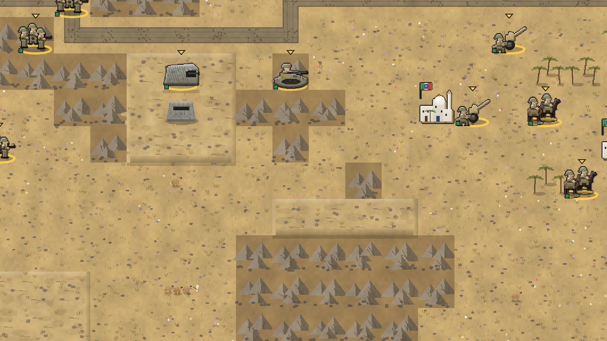
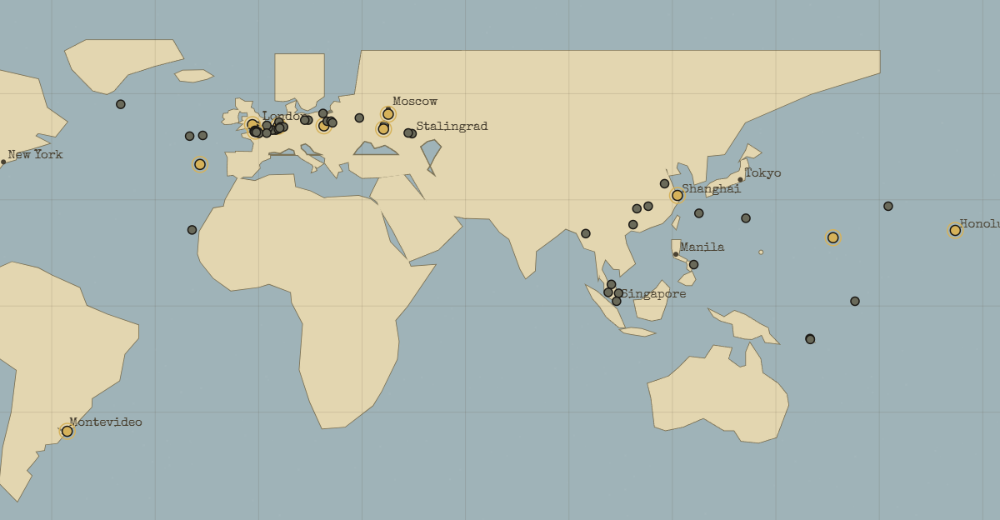

# Bit-zkrieg: Iron Front '44

**[Play it free in your browser](https://tristanhotham.com/games/iron-front-44/play/)** · [Game page and trailer](https://tristanhotham.com/games/iron-front-44/)



A Second World War turn-based tactics game in the Advance Wars mould. There are 149 battles in twenty-three campaigns: Khalkhin Gol, the Winter War, Shanghai in 1937, the invasion of Poland, the fall of France, the Desert War from Beda Fomm to Tunis, Italy's own war from the Pindus to Filottrano, the Atlantic, the carrier war from Taranto to Ten-Go, Pearl Harbor to Singapore, the Pacific, China's War of Resistance, and Normandy and the Eastern Front through to the Reichstag. Every battle has a historical briefing, the real forces and generals, and an aftermath telling you what actually happened.







## Modes

- **Campaigns:** twenty-three campaigns, Allied and Axis, 149 battles from Khalkhin Gol in 1939 to the Kuril Islands in 1945, each with its history: among them the Winter War, the Desert Fox, Barbarossa, Burma, the Australians, Canada and Poland, the Philippines and Zhukov in the Far East.
- **Skirmish:** random land and island maps, any two armies, and a choice of enemy general.
- **Last Stand:** hold your HQ against growing waves. You can pick your starting money and troops.
- **Dead of Night:** zombie wave defence. The dead you kill rise again.
- **Map Builder:** paint terrain and units, share maps as codes, and run an AI balance check.
- **Archive and Service Record:** vehicles, generals, battles, a glossary, statistics and medals.
- **Multiplayer:** hotseat, or turn codes (play by mail).

## Controls

Play with the mouse, touch, keyboard or a gamepad. Click a unit, then click where to move and what to attack. **R** shows one unit's threat range. **T** (or the **Danger** button) shows every tile the enemy can hit next turn. Full help is in the game.

## Running it

- Online: [tristanhotham.com/games/iron-front-44/play](https://tristanhotham.com/games/iron-front-44/play/)
- Locally: clone the repo and serve the folder with any web server (for example `npx serve`), then open `index.html`. Opening the file directly works, but browsers block the music that way.

## Building

The game is plain JavaScript with no dependencies. The source modules live in `src/`, and `build.ps1` joins them in order with `src/shell.html` and `src/style.css` into the single file `index.html`.

```powershell
.\build.ps1             # writes index.html (and dist/ for an offline copy)
.\serve.ps1             # local dev server on http://localhost:8790/
node tools\credits.js   # regenerates CREDITS.md from src/music.js
```

Open `index.html#validate` to run the built-in checks. Open `#testers` to watch the eight AI tester personas play and report back.



## About

Made by [Tristan Hotham](https://tristanhotham.com/) with the help of Claude, an AI system by Anthropic. German national flags are shown as they were historically; Settings can switch them to the Balkenkreuz.

More games: [tristanhotham.com/games](https://tristanhotham.com/games/)

## Licence

The code is released under the [MIT licence](LICENSE). The music and recorded sounds are public domain or freely licensed recordings, mostly from Wikimedia Commons. They are **not** covered by the MIT licence; see [CREDITS.md](CREDITS.md) for each one's source and licence.
